  

## Project

<table><tr><td>

### [graftui](https://github.com/0xmmhh/graftui)

An animated git TUI: merge, stage, commit, stash, switch and undo, and see the real `git` commands as they run.

It's in alpha and help is welcome: [help wanted](https://github.com/0xmmhh/graftui#help-wanted).

</td></tr></table>

## Tech stack

  
  
  
  
  
  
  
  
  
  

## Contact

  

